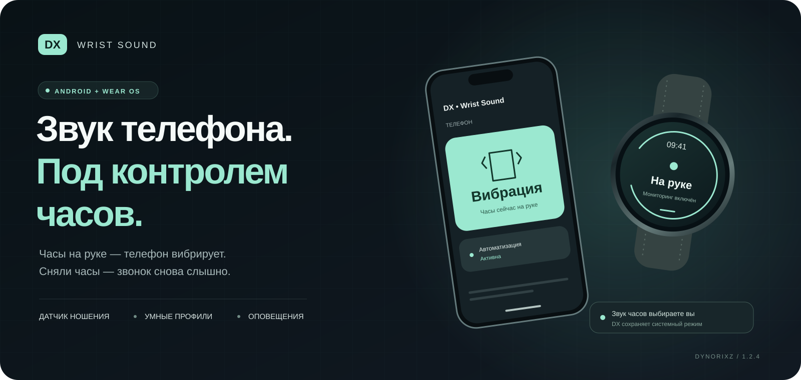
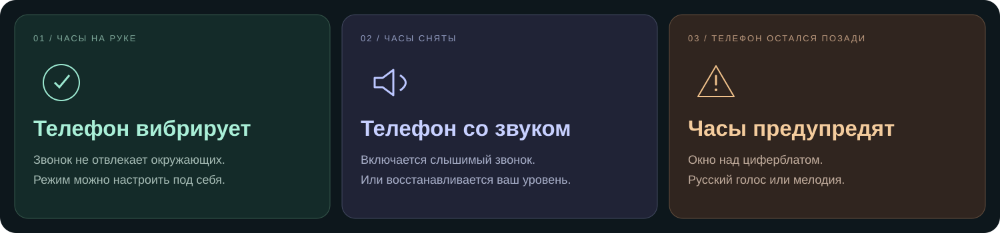

<div align="center">



<br>

[](docs/installation.md)
[](docs/installation.md)
[](https://github.com/Dynorixz/dx-wrist-sound/releases/tag/v1.2.4)
[](docs/building.md)

**Часы на руке — телефон вибрирует. Сняли часы — звонок снова слышно.**

[Скачать APK](#скачать) · [Установка](docs/installation.md) · [Разрешения](docs/permissions.md) · [Решение проблем](docs/troubleshooting.md) · [English](docs/README.en.md)

</div>

---

DX • Wrist Sound связывает звук звонка Android-телефона с датчиком ношения Wear OS часов. Приложение различает **часы на руке**, **часы сняты** и **нет достоверных данных**. Само подключение по Bluetooth не считается доказательством ношения.



## Что умеет

| Возможность | Как это работает |
| --- | --- |
| **Автоматический звук телефона** | Вибрация, беззвучный режим или свой уровень при ношении; максимум, свой уровень или восстановление прежнего звука при снятии. |
| **Звук часов остаётся вашим** | DX 1.2.4 сохраняет выбранный системный режим и мелодию часов. Для звука включите его в настройках самих часов. |
| **«Вы забыли телефон»** | После подтверждённой потери связи часы показывают предупреждение. На выбор — русская офлайн-речь или мелодия. |
| **Окно над циферблатом** | Иллюстрация оставленного телефона и кнопка «Понятно»; требуется отдельный доступ поверх других окон. |
| **Защита от коротких сбоев** | Независимое подтверждение надевания и снятия, проверка локального узла и защита от повторной тревоги. |
| **Фоновая работа** | Foreground service, восстановление подписки датчика и периодическая проверка службы. Нужны разрешения фоновой работы. |
| **Диагностика** | Состояние датчика, доступы, связь, тесты режимов и последние 100 событий. |
| **Без собственного аккаунта** | Настройки хранятся локально. Для связи используется Google Play services Data Layer. |

## Скачать

**Для новой установки — пара Release 1.2.4:**

| Телефон | Часы |
| :---: | :---: |
| [**Скачать Phone · Release APK**](https://github.com/Dynorixz/dx-wrist-sound/releases/download/v1.2.4/DX-Wrist-Sound-Phone-1.2.4-release.apk) | [**Скачать Wear · Release APK**](https://github.com/Dynorixz/dx-wrist-sound/releases/download/v1.2.4/DX-Wrist-Sound-Wear-1.2.4-release.apk) |
| Android 11 / API 30 и выше | Wear OS 3 / API 30 и выше |

**Обновляете раннюю локальную версию?** В релизе есть отдельная пара **Compatible** с прежней подписью. Она предназначена для обновления старых локальных установок с сохранением данных. Оба устройства должны использовать одну пару подписи.

<details>
<summary><b>Скачать Compatible и проверить подпись</b></summary>

- [Phone 1.2.4 · Compatible](https://github.com/Dynorixz/dx-wrist-sound/releases/download/v1.2.4/DX-Wrist-Sound-Phone-1.2.4-compatible.apk)
- [Wear 1.2.4 · Compatible](https://github.com/Dynorixz/dx-wrist-sound/releases/download/v1.2.4/DX-Wrist-Sound-Wear-1.2.4-compatible.apk)
- [Контрольные суммы всех файлов](https://github.com/Dynorixz/dx-wrist-sound/releases/download/v1.2.4/SHA256SUMS.txt)
- [Подпись, сертификаты и совместимость обновлений](docs/release-signing.md)

Compatible использует прежний локальный debug-сертификат, но это **release-сборка с отключённой отладкой**. У Release другой сертификат. Смешивать Phone Release с Wear Compatible нельзя.

</details>

[**Все файлы релиза и ZIP исходников →**](https://github.com/Dynorixz/dx-wrist-sound/releases/tag/v1.2.4)

## Первый запуск

1. Установите **оба APK одной пары** и откройте DX на телефоне и часах.
2. На телефоне разрешите изменение звука через доступ **«Не беспокоить»**, уведомления и подключение к устройствам, если Android запрашивает его.
3. На часах включите мониторинг. Разрешите уведомления и фоновую работу; доступ к датчику запрашивается только при необходимости.
4. На телефоне включите автоматизацию и выберите нужные часы.
5. Наденьте часы, дождитесь состояния **«Часы на руке»**, затем снимите их и проверьте звук телефона.
6. Для предупреждения об оставленном телефоне откройте на часах **Оповещения**. Выберите голос или мелодию и нажмите **Проверить окно**.

На некоторых Samsung доступ к окну над циферблатом выдаётся через ADB: системная страница может показывать «Недоступно». В DX есть собственная проверка фактического доступа и инструкция. [Установка с командами →](docs/installation.md#окно-над-циферблатом)

## Логика по умолчанию

| Событие | Результат |
| --- | --- |
| Подтверждённое надевание · 3 секунды | Телефон переходит в вибрацию. |
| Подтверждённое снятие · 5 секунд | Телефон включает максимальную громкость звонка. |
| Неизвестное состояние датчика | Само это событие звук не меняет. |
| Подтверждённая потеря локальной связи · 15 секунд | Телефон включает защитный режим с максимальной громкостью. |
| Потеря телефона · 30 секунд, часы надеты | На часах появляется предупреждение и выбранное звуковое оповещение. |
| Связь восстановлена до подтверждения потери | Тревога отменяется. |

Задержки настраиваются. Они отсчитываются от получения системного события; фактическое обнаружение обрыва зависит от Wear OS. Режим DND и настройки прошивки могут подавлять звонки даже при высокой громкости.

## Что изменилось в 1.2.4

Устранено принудительное переключение часов в вибрацию при выборе мелодии. Режим звука часов больше не меняется по сигналу датчика или конфигурации телефона. Новый стандартный профиль — **вибрация на телефоне при ношении, звук после снятия**; миграция применяется один раз и сохраняет остальные настройки.

[История версий](CHANGELOG.md) · [Отчёт проверки 1.2.4](BUILD_VERIFICATION.md)

## Для разработчиков

Проект разделён на три модуля:

```text
mobile/   Android UI, управление звонком, автоматизация и диагностика
wear/     Wear OS UI, off-body датчик, фоновая служба и оповещения
shared/   протокол, DataStore, политики, debounce и регрессионные тесты
docs/     установка, разрешения, архитектура и оформление
tools/    сборка, подпись и упаковка переносимых исходников
```

**Стек:** Kotlin, Jetpack Compose Material 3, Wear Compose Material 3, Coroutines / Flow, DataStore, Google Play services Data Layer. Минимальный API — 30; target — 36. Версии сборки закреплены в каталоге Gradle.

В проверке релиза 1.2.4 прошли **52 unit-теста**, lint — без ошибок. Это результат проверки от 16.10.2026; аппаратные сценарии и ограничения прошивок описаны отдельно. Изменения оформления репозитория не меняют APK.

[Собрать из исходников](docs/building.md) · [Архитектура](ARCHITECTURE.md) · [Внести изменения](CONTRIBUTING.md) · [Обработка данных](PRIVACY.md)

## Ограничения, которые полезно знать

- Нужен аппаратный off-body датчик и Google Play services. Совместимость конкретной модели проверяется в диагностике.
- Доставка события под PIN зависит от wake-up возможностей датчика. Краткое удержание CPU помогает обработке уже полученного события.
- Фоновое восстановление зависит от настроек батареи и правил прошивки. После системной принудительной остановки приложение нужно открыть вручную.
- DX меняет звук звонка телефона. Мелодии и выбранный режим часов задаются в их системных настройках.
- Транспорт Data Layer выбирает Google Play services. Проверка локального узла не является гарантией конкретного физического маршрута передачи.

## Автор и поддержка

Проект **Dynorixz / DX**. В обоих приложениях ссылки доступны в разделе «О приложении».

[**Telegram · @dynorixz**](https://t.me/dynorixz) · [**GitHub · Dynorixz**](https://github.com/Dynorixz) · [**Поддержать проект**](https://pay.cloudtips.ru/p/5d56061d)

Нашли ошибку? [Создайте issue](https://github.com/Dynorixz/dx-wrist-sound/issues/new/choose), укажите модели устройств, версии систем и шаги воспроизведения.

<sub>Лицензия на собственный код отдельно не объявлена. Происхождение и лицензия сторонних иконок — в <a href="NOTICE.md">NOTICE</a>. Иллюстрации README — схемы интерфейса, а не снимки экрана устройства.</sub>
